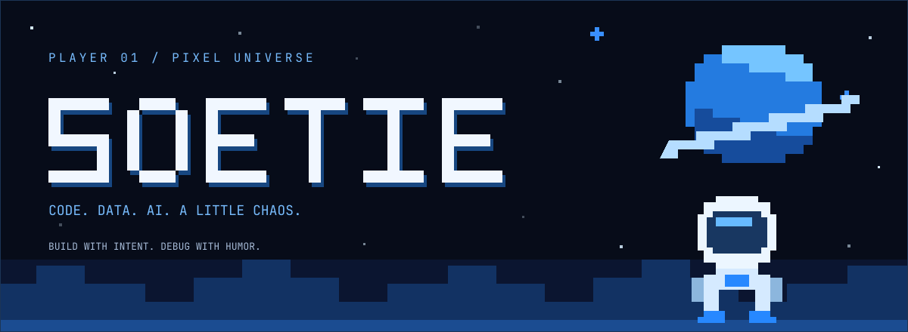

<div align="center">

<picture>
  <source media="(prefers-reduced-motion: reduce)" srcset="./assets/pixel-universe.svg">
  
</picture>

**Developer · Vibe Coder · AI Prompt Engineer · Data Engineer**

*Building useful things. Occasionally touching grass.*<br>
*Xây những thứ hữu ích. Thỉnh thoảng ra ngoài chạm cỏ.*

[](https://github.com/Soetiee2207?tab=repositories)
[](https://www.facebook.com/sah.soetie.2207)

</div>

---

### 👾 PLAYER 01 / NGƯỜI CHƠI 01

I'm **SOETIE**. I build backends, work with data, and turn ideas into code with AI along for the ride. Equal parts curiosity, focus, and questionable jokes.

Mình là **SOETIE**. Mình xây backend, làm việc với dữ liệu và biến ý tưởng thành code cùng AI. Một chút tò mò, một chút tập trung, thêm vài câu đùa chưa qua kiểm duyệt.

```text
SOCIAL MODE    Introvert ↔ Extrovert / Hướng nội ↔ Hướng ngoại
FIRST CONTACT  Quiet / Mới gặp hơi lạnh
AFTER UNLOCK   Comedy mode / Quen rồi bật chế độ tấu hài
PALETTE        Ocean blue · Black · White / Xanh biển · Đen · Trắng
```

> Serious about the build. Playful about the journey.<br>
> Làm sản phẩm nghiêm túc. Giữ hành trình vui vẻ.

### 🎒 INVENTORY / BỘ ĐỒ NGHỀ

Technologies I actually use in my projects.<br>
Những công nghệ mình thực sự dùng trong các dự án.


### 🚀 FEATURED QUEST / NHIỆM VỤ NỔI BẬT

<table>
<tr>
<td>

#### [SalonHub ↗](https://github.com/Soetiee2207/SalonHub)

**One salon. Many moving parts. One place to manage them.**<br>
**Một salon, nhiều nghiệp vụ, một nơi để quản lý.**

A system for managing salon inventory, sales, accounting, and scheduling.<br>
Hệ thống quản lý **kho hàng, bán hàng, kế toán và sắp lịch** cho salon.

| Quest objectives / Bài toán | Scope / Phạm vi |
| :--- | :--- |
| 📦 Inventory / Kho hàng | Inventory management / Quản lý kho |
| 🛒 Sales / Bán hàng | Sales management / Quản lý bán hàng |
| 🧾 Accounting / Kế toán | Accounting management / Quản lý kế toán |
| 📅 Scheduling / Sắp lịch | Schedule management / Quản lý lịch |

**Achievement unlocked / Thành tựu đã mở khóa**<br>
Built the entire backend from scratch, end to end.<br>
Tự xây dựng toàn bộ backend từ đầu đến cuối — phần mình tự hào nhất.

[**Enter the repository → / Khám phá mã nguồn →**](https://github.com/Soetiee2207/SalonHub)

</td>
</tr>
</table>

### 🛰️ CO-OP CHANNEL / KÊNH KẾT NỐI

Have an idea, a backend puzzle, or a joke worth sharing? Let's talk.<br>
Có ý tưởng, bài toán backend, hay câu đùa đủ mặn? Kết nối với mình nhé.

**[Facebook ↗](https://www.facebook.com/sah.soetie.2207)** · **[GitHub ↗](https://github.com/Soetiee2207)**

---

<div align="center">

**SAVE YOUR PROGRESS. STAY CURIOUS.**<br>
**Lưu tiến độ. Giữ sự tò mò.**

<sub>Thanks for visiting my universe. / Cảm ơn đã ghé vũ trụ của mình.</sub>

</div>
